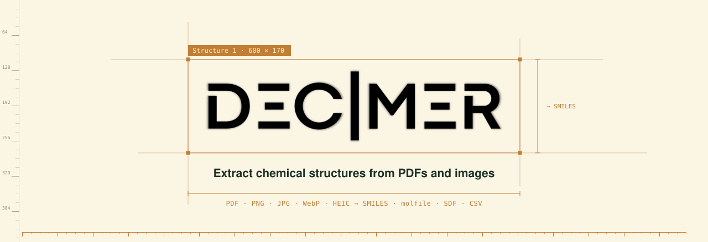
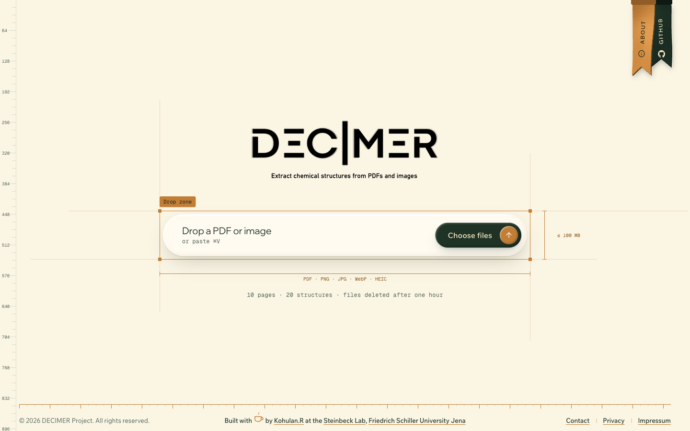
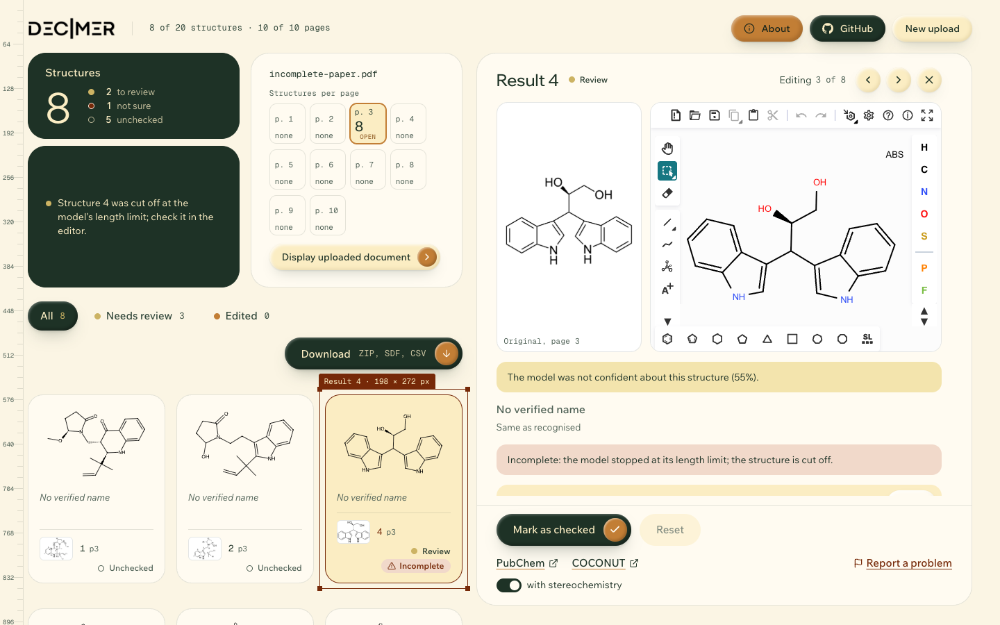
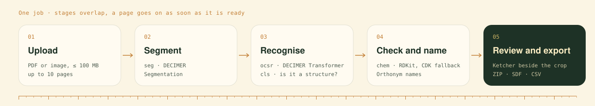

<div align="center">

<a href="https://decimer.ai"></a>

<br>

[](https://decimer.ai)
[](https://doi.org/10.1038/s41467-023-40782-0)
[](LICENSE)

[](https://www.python.org)
[](https://www.tensorflow.org)
[](https://react.dev)
[](https://github.com/epam/ketcher)
[](https://www.rdkit.org)
[](deploy/README.md)

**[Use it](https://decimer.ai)** &nbsp;·&nbsp; **[How it works](#how-it-works)** &nbsp;·&nbsp; **[Run your own](#run-your-own)** &nbsp;·&nbsp; **[Cite](#cite)**

</div>


**DECIMER** (Deep lEarning for Chemical IMagE Recognition) finds chemical structures in scientific papers and images and turns them into machine-readable SMILES. Drop in a PDF or an image. DECIMER cuts out every structure, reads it, checks it, and puts each one beside the original crop so you can correct it before you download.

> [!NOTE]
> This is the next-generation decimer.ai: a FastAPI job API, three model services and a React app. It replaces the Laravel 8 site ([`DECIMER.ai-legacy`](https://github.com/Steinbeck-Lab/DECIMER.ai-legacy)). The models and their predictions are the same as before.

<div align="center">

</div>

## What it does

<table>
<tr>
<td width="50%" valign="top">

#### Read documents
PDF, PNG, JPG, WebP and HEIC, up to 100 MB, 10 pages and 20 structures per job. Drop a file or paste an image. Uploads are deleted after one hour.

</td>
<td width="50%" valign="top">

#### Find every structure
DECIMER Segmentation cuts each structure out of the page. A classifier flags crops that may not be a chemical structure.

</td>
</tr>
<tr>
<td width="50%" valign="top">

#### Recognise and check
The DECIMER Transformer writes the SMILES. RDKit checks it, CDK reads what RDKit refuses, and Orthonym adds a name only when the name is verified.

</td>
<td width="50%" valign="top">

#### Review, then export
Every result has a status: unchecked, review, not sure, edited, checked. Correct a structure in Ketcher beside its original crop, then download ZIP, SDF or CSV.

</td>
</tr>
</table>

<div align="center">

</div>

## How it works



One job runs through three model services and a chemistry service, behind a small API. The stages overlap: a page goes to segmentation as soon as it is rendered, and a crop goes to recognition as soon as its place in the job is known.

<table>
<tr>
<td align="center" width="33%" valign="top">
<br>
<b>DECIMER Segmentation</b><br>
<sub>Finds and cuts out structures with Mask R-CNN</sub><br>
<sub><a href="https://github.com/Kohulan/DECIMER-Image-Segmentation">code</a> · <a href="https://doi.org/10.1186/s13321-021-00496-1">paper</a> · <code>services/seg</code></sub>
</td>
<td align="center" width="33%" valign="top">
<br>
<b>DECIMER Transformer</b><br>
<sub>Reads a structure image and writes SMILES</sub><br>
<sub><a href="https://github.com/Kohulan/DECIMER-Image_Transformer">code</a> · <a href="https://doi.org/10.1186/s13321-021-00538-8">paper</a> · <code>services/ocsr</code></sub>
</td>
<td align="center" width="33%" valign="top">
<br>
<b>DECIMER Image Classifier</b><br>
<sub>Tells chemical structures from other images</sub><br>
<sub><a href="https://github.com/Steinbeck-Lab/DECIMER-Image-Classifier">code</a> · <code>services/cls</code></sub>
</td>
</tr>
</table>

| Path | What |
|---|---|
| [`web/`](web) | React app: Vite, Mantine, one Ketcher editor |
| [`api/`](api) | FastAPI job API, arq worker on Redis, ingest sidecar, exports |
| [`services/`](services) | `seg`, `ocsr`, `cls` (TensorFlow 2.15.1) and `chem` (RDKit, CDK, Orthonym), each a small HTTP service |
| [`deploy/`](deploy) | Dockerfiles, Compose project, nginx edge, self-hosted GlitchTip |
| [`golden/`](golden) | The golden-set paper, its labels and the check every model change must pass |

## Run your own

You need Docker with about 24 GB of memory (for the default layout; `deploy/README.md` shows how to size it), [uv](https://docs.astral.sh/uv/) and Node 24. The model weights are not in git.

```bash
git clone https://github.com/Steinbeck-Lab/DECIMER.ai && cd DECIMER.ai

deploy/weights/fetch.sh --zenodo seg ocsr chem      # weights and jars, checked against SHA256SUMS
cp deploy/.env.example deploy/.env                  # then fill in the secrets: deploy/README.md, "First start"

DC="docker compose -p decimer-next -f deploy/compose.yaml --env-file deploy/.env"
$DC build && $DC up -d                              # ocsr is the slowest to become healthy
curl -fsS http://127.0.0.1:8090/readyz              # {"status":"ready"}
```

Then open **http://127.0.0.1:8090**.

> [!TIP]
> On Apple Silicon the images build natively for linux/arm64. Set `SEG_MEM_LIMIT=6g` in `deploy/.env`.

<details>
<summary><b>Develop and test</b></summary>
<br>

Each Python project has its own uv lock file. Run `uv sync --locked` in `api/`, `services/common`, `services/seg`, `services/ocsr`, `services/cls`, `services/chem` and `golden/`. `chem` also needs a Java 21 runtime (`JAVA_HOME`).

```bash
cd web && npm ci && cd ..
scripts/check.sh            # lint, types, unit tests, the end-to-end and browser tests
scripts/check.sh --no-e2e   # without the Docker-based tests
```

No change to a model, TensorFlow, RDKit, CDK or the PDF renderer ships without the golden-set check ([`golden/README.md`](golden/README.md)).

More: [`deploy/README.md`](deploy/README.md) (images, settings, operations) · [`golden/README.md`](golden/README.md) (the golden-set check)

</details>


## Cite

If DECIMER helps your research, please cite:

> Rajan, K., Brinkhaus, H. O., Agea, M. I., Zielesny, A. & Steinbeck, C. **DECIMER.ai: an open platform for automated optical chemical structure identification, segmentation and recognition in scientific publications.** *Nature Communications* 14, 5045 (2023). [doi:10.1038/s41467-023-40782-0](https://doi.org/10.1038/s41467-023-40782-0)

```bibtex
@article{rajan2023decimer,
  title     = {DECIMER.ai: An open platform for automated optical chemical
               structure identification, segmentation and recognition in
               scientific publications},
  author    = {Rajan, Kohulan and Brinkhaus, Henning Otto and
               Agea, Maria Inmaculada and Zielesny, Achim and
               Steinbeck, Christoph},
  journal   = {Nature Communications},
  volume    = {14},
  number    = {1},
  pages     = {5045},
  year      = {2023},
  doi       = {10.1038/s41467-023-40782-0}
}
```

<details>
<summary><b>More DECIMER papers</b></summary>
<br>

- **Hand-drawn structures (2024).** Rajan, Brinkhaus, Zielesny, Steinbeck. Advancements in hand-drawn chemical structure recognition through an enhanced DECIMER architecture. *J. Cheminform.* 16, 78. [doi:10.1186/s13321-024-00872-7](https://doi.org/10.1186/s13321-024-00872-7)
- **Segmentation (2021).** Rajan, Brinkhaus, Sorokina, Zielesny, Steinbeck. DECIMER-Segmentation: automated extraction of chemical structure depictions from scientific literature. *J. Cheminform.* 13, 20. [doi:10.1186/s13321-021-00496-1](https://doi.org/10.1186/s13321-021-00496-1)
- **Transformer (2021).** Rajan, Zielesny, Steinbeck. DECIMER 1.0: deep learning for chemical image recognition using transformers. *J. Cheminform.* 13, 61. [doi:10.1186/s13321-021-00538-8](https://doi.org/10.1186/s13321-021-00538-8)
- **The first DECIMER (2020).** Rajan, Zielesny, Steinbeck. DECIMER: towards deep learning for chemical image recognition. *J. Cheminform.* 12, 65. [doi:10.1186/s13321-020-00469-w](https://doi.org/10.1186/s13321-020-00469-w)

</details>

## Contribute

Found a wrong structure or a bug? [Open an issue](https://github.com/Steinbeck-Lab/DECIMER.ai/issues), or use **Report a problem** on a result. Pull requests are welcome. Run `scripts/check.sh` before you open one.


<div align="center">

<a href="https://cheminf.uni-jena.de"></a>

Built with ☕ by [**Kohulan.R**](https://www.kohulanr.com) at the [Steinbeck Lab](https://cheminf.uni-jena.de), Friedrich Schiller University Jena

<sub>Also from the lab: [COCONUT](https://coconut.naturalproducts.net) · [DECIMER Segmentation](https://github.com/Kohulan/DECIMER-Image-Segmentation) · [DECIMER Transformer](https://github.com/Kohulan/DECIMER-Image_Transformer) · [DECIMER Image Classifier](https://github.com/Steinbeck-Lab/DECIMER-Image-Classifier)</sub>

<br>

<sub>Funded by the [Carl Zeiss Foundation](https://www.carl-zeiss-stiftung.de/en) and the [Deutsche Forschungsgemeinschaft](https://www.dfg.de/) (DFG) under [ChemBioSys](https://www.chembiosys.de/en/) (Project INF), project number 239748522, SFB 1127.</sub>

<a href="https://www.dfg.de/"></a>
&nbsp;&nbsp;&nbsp;
<a href="https://www.chembiosys.de/en/welcome.html"></a>

<sub>MIT License · © 2026 Kohulan Rajan, Steinbeck-Lab</sub>

</div>
